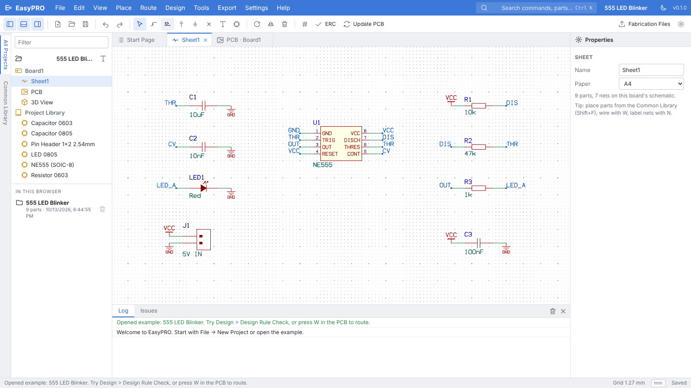
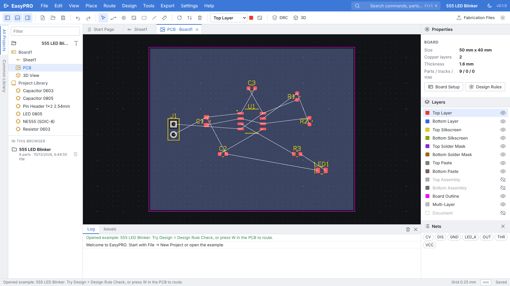
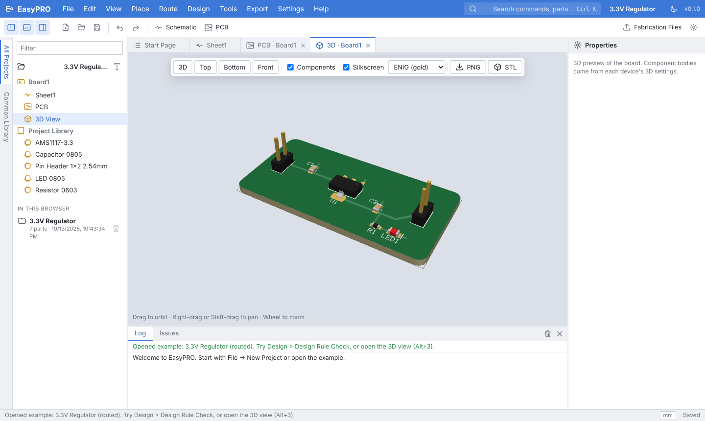

# EasyPRO

Free, local-first electronic design in the browser: schematic capture, PCB
layout, 3D preview and fabrication output. The interface follows EasyEDA Pro's
layout, so it feels familiar, but there are no ads, no account and no
vendor lock-in.

**Open the app:** https://flotrpy.github.io/EDA-EasyPRO/



| PCB layout | 3D preview |
|---|---|
|  |  |

## Features

- **Schematic**: multi-sheet, wires with automatic junctions, net labels,
  power and ground flags, no-connect flags, annotation, electrical rule check.
- **PCB**: update from schematic, ratsnest, interactive 45° routing with live
  clearance checking, vias while routing, copper areas with clearance and
  dead-copper removal, via stitching, board outline tool, measure tool,
  align/distribute, 1–6 copper layers, design rules with net classes and
  real-time DRC (clearance, widths, drills, annular rings, board edge,
  overlapping parts, silkscreen, dangling tracks, unrouted nets).
- **3D**: board with mask, copper, silkscreen and drill holes; parametric
  component bodies whose leads follow the footprint pads; OBJ import; PNG export.
- **Library**: 46 ready parts (passives 0402–1206, diodes, LEDs, transistors,
  MOSFETs, regulators, op-amps, NE555, ATmega328P, STM32F103, ESP32-WROOM,
  CH340C, USB-C, 1xN and 2xN headers…), symbol and footprint editors, an IC Symbol Wizard
  that builds a part from a pasted pin list, and KiCad footprint/symbol import.
- **Fabrication**: Gerber X2, Excellon drill, BOM and pick-and-place CSV,
  zipped with the naming each fab expects (JLCPCB, PCBWay, OSH Park,
  Eurocircuits, generic), plus an IPC-D-356 netlist for electrical test.
  Also assembly drawings, SVG, KiCad and CSV netlists, and STL of the board.
- **Your data stays yours**: autosave to the browser, real files with Ctrl+S,
  version history, offline support. Nothing is uploaded.
- **Quick to drive**: Ctrl+K command palette, single-key tools (W wire/track,
  N label, V via…), every shortcut rebindable, right-click menus, dark theme.

What changed compared to EasyEDA and why is documented in
[docs/RESEARCH.md](docs/RESEARCH.md).

## Using it

1. **File → New Project**, or open one of the examples from the start page:
   a 555 LED blinker, or a fully routed 3.3 V regulator board.
2. Place parts from the **Common Library** tab on the left (Shift+F), wire
   them with **W**, name nets with **N**, add **P**ower and **G**round flags.
3. **Design → Update PCB** (Ctrl+U). Drag the footprints onto the board.
4. Route with **W**; press **V** to drop a via and change layer, **/** to flip
   the bend. Add copper areas with **E**.
5. **Design → DRC**, look at it in **3D** (Alt+3), then
   **Export → Fabrication Package** (Ctrl+Alt+G).

Press **?** for the full shortcut list.

## Building locally

Requirements: Rust (stable) with the `wasm32-unknown-unknown` target, and
[Trunk](https://trunkrs.dev).

```sh
rustup target add wasm32-unknown-unknown
cargo install trunk          # or download a release binary
cd app && trunk serve --open # http://localhost:8080
```

Run the tests (native, no browser needed):

```sh
cargo test --workspace
cargo run -p easypro-export --example fab_package -- out.zip jlcpcb 3.3v   # sample fab package
```

## Project layout

| Path | What |
|---|---|
| `crates/core` | Document model, geometry, built-in library, connectivity, ERC, DRC, copper pours, routing helpers, KiCad import, file format |
| `crates/export` | Gerber, Excellon, BOM/CPL, IPC-D-356, SVG, assembly drawings, netlists, ZIP, fab presets |
| `crates/render` | WebGL2 2D renderer: tessellator, camera, shaders |
| `crates/view3d` | WebGL2 3D board viewer and component body generator |
| `app` | Leptos web app: editors, panels, dialogs, storage |

The file format is described in [docs/FILE_FORMAT.md](docs/FILE_FORMAT.md).

## Not done yet

Honest gaps compared to EasyEDA Pro: no SPICE simulation, no autorouter or
push-and-shove routing, no live distributor stock/pricing, no real-time
multi-user collaboration, no STEP import (OBJ only).

## Licence

MIT. See [LICENSE](LICENSE).
